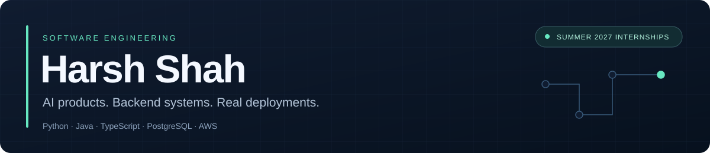
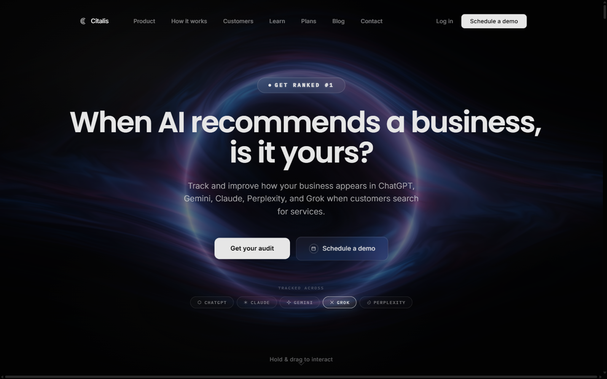
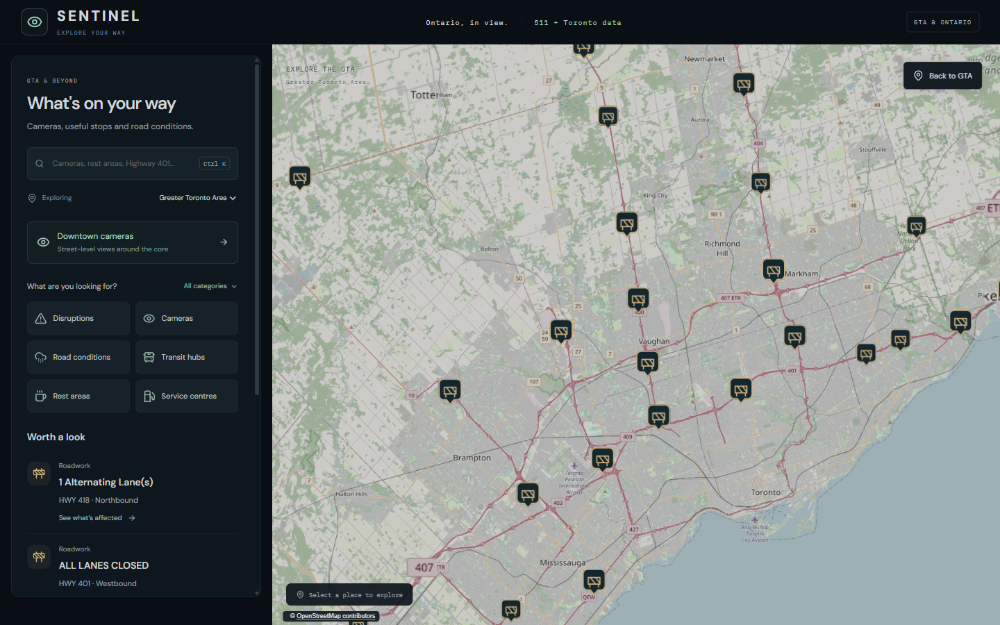
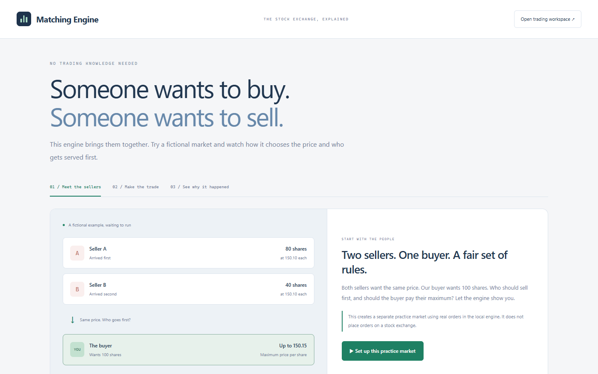
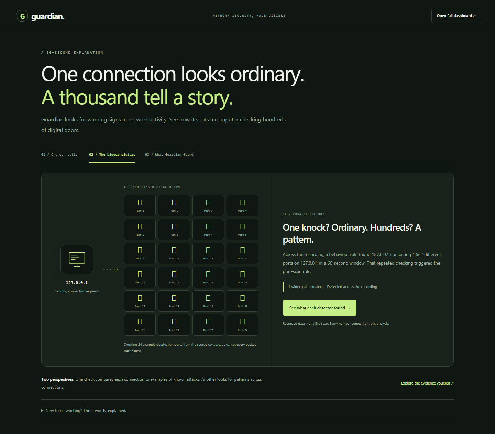
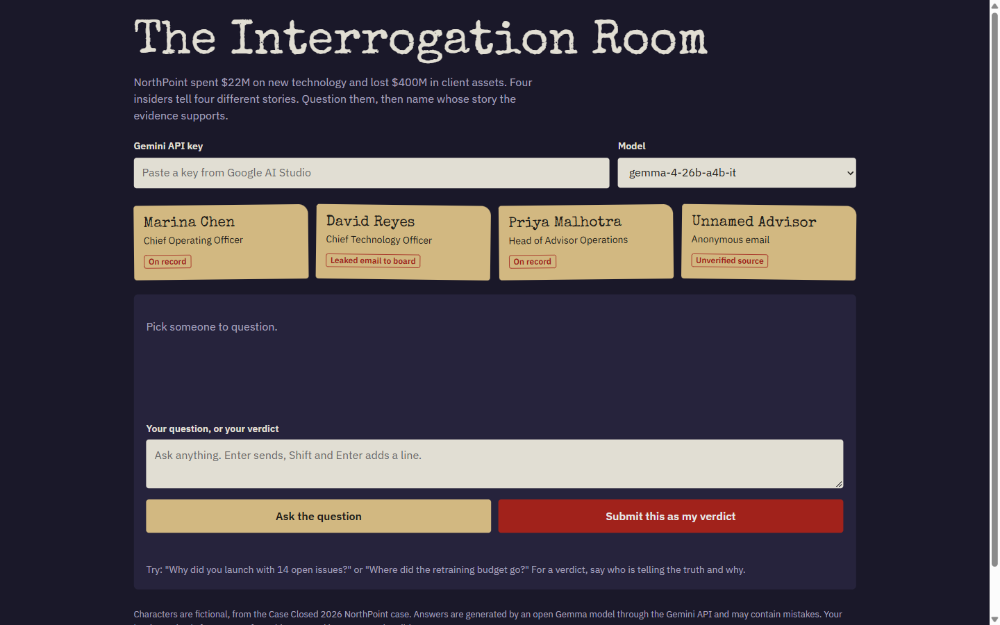

I'm a **Computer Science student at Sheridan College**, specialising in Network Engineering, and **co-founder of [Citalis](https://trycitalis.com)**. I build products in Python, Java, and TypeScript, with a focus on the APIs, data pipelines, and databases behind them.

**Seeking Summer 2027 software engineering internships.**

[Citalis](https://trycitalis.com) · [LinkedIn](https://www.linkedin.com/in/harsh-shah-301322214/) · [Email](mailto:shharshn@sheridancollege.ca)

## Building Citalis

**When someone asks an AI assistant for a business recommendation, does your business appear?**

[Citalis](https://trycitalis.com) helps businesses measure their appearance in AI answers, compare competitors, and prioritise improvements. My work includes a Python audit engine, location-based response caching, a TypeScript dashboard, and report exports.

**[Visit the product →](https://trycitalis.com)** &nbsp; **[Read the engineering case study →](https://github.com/harshpro02/citalis-showcase)**

## Selected projects

<table>
<tr>
<td width="50%" valign="top">
<h3><a href="https://github.com/harshpro02/sentinel-to">Sentinel</a></h3>

Explore Ontario road reports and nearby camera snapshots. Persistent incident history, cached official feeds, and tested S3 backup recovery.

Python · FastAPI · React · PostgreSQL · AWS

<a href="https://sentinel.54.162.93.68.sslip.io">Live app</a> · <a href="https://github.com/harshpro02/sentinel-to">Code & architecture</a>

</td>
<td width="50%" valign="top">
<h3><a href="https://github.com/harshpro02/trade-matching-engine">Crossing</a></h3>

See how buy and sell orders become trades. Price-time matching, partial fills, account positions, and transaction-safe updates.

Java · Spring Boot · PostgreSQL · JUnit · Docker

<a href="https://exchange.54.162.93.68.sslip.io">Live app</a> · <a href="https://github.com/harshpro02/trade-matching-engine">Code & matching rules</a>

</td>
</tr>
<tr>
<td width="50%" valign="top">
<h3><a href="https://github.com/harshpro02/network-security-ml">Guardian</a></h3>

Understand suspicious network traffic through packet-capture replay and flow inspection. Combines an ML detector with cross-flow scan alerts.

Python · FastAPI · Scapy · scikit-learn · GitHub Actions

<a href="https://guardian-dty5.onrender.com">Live demo</a> · <a href="https://github.com/harshpro02/network-security-ml">Code & evaluation</a>

</td>
<td width="50%" valign="top">
<h3><a href="https://github.com/harshpro02/The-Interrogation-Room">Alibi</a></h3>

Question four AI characters and build an evidence-based verdict. Built in one day at Case Closed 2026.

<strong>Winner — Best Use of Gemma (MLH), October 2026.</strong>

JavaScript · HTML/CSS · Gemma via Gemini API

<a href="https://harshpro02.github.io/The-Interrogation-Room/">Open game</a> · <a href="https://github.com/harshpro02/The-Interrogation-Room">Code & setup</a>

</td>
</tr>
</table>

**Team project: [Patch Me If You Can](https://github.com/PrabhnoorGrover007/Patch-me-if-you-can)** — vulnerability prioritisation built for Sheridan Datathon's IBM track. Combines time-based evaluation, exploit signals, IBM Granite embeddings, and a dashboard for investigating which vulnerabilities to patch first.

Guardian's free demo host may need a moment to wake. Alibi requires your own Gemini API key; its page explains how the key is used.

## Tools I use

**Languages:** Python, Java, TypeScript, JavaScript, SQL 
**Backend & data:** FastAPI, Spring Boot, Fastify, PostgreSQL, scikit-learn 
**Frontend & delivery:** React, Next.js, Docker, AWS EC2/S3, GitHub Actions

Outside software: powerlifting, running, and cooking.
